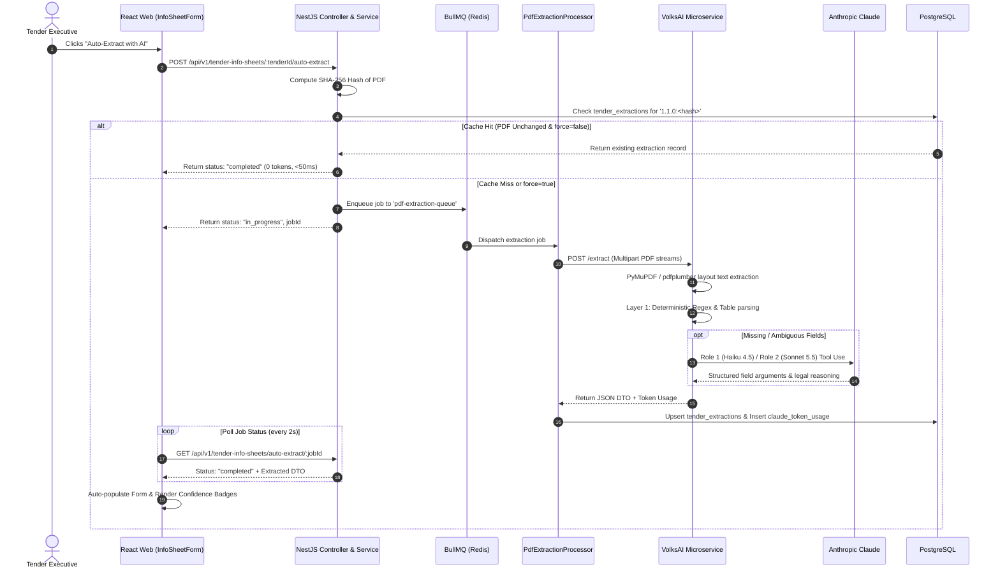

When a Tender Executive uploads a tender document and clicks **"Auto-Extract with AI"**, the system executes an 8-step pipeline spanning React, NestJS, BullMQ, Redis, PostgreSQL, and VolksAI.

## Architecture Flow Diagram

---

## Detailed Step-by-Step Execution Trace

### Step 1: User Triggers Extraction in Web UI
* **File:** `web/src/modules/tendering/info-sheet/components/InfoSheetForm.tsx`
* **Function:** `handleAutoExtract(force = false)`
* The Tender Executive clicks "Auto-Extract with AI". The UI sets `extracting = true` and dispatches `POST /api/v1/tender-info-sheets/:tenderId/auto-extract` with `{ force: boolean }`.

### Step 2: Controller Receives Request
* **File:** `api/src/modules/tendering/info-sheets/info-sheets.controller.ts`
* **Route:** `@Post(':tenderId/auto-extract')`
* Authenticates the user session via JWT and passes execution to `InfoSheetsService.autoExtractFromPdf()`.

### Step 3: Document File Path Resolution
* **File:** `api/src/modules/tendering/info-sheets/info-sheets.service.ts`
* **Function:** `resolveTenderDocuments(tenderId)`
* Queries `tender_infos` in PostgreSQL for attached documents:
  * Primary GeM bid document (`pdf_file`)
  * Optional Additional Terms and Conditions (`atc_files`, up to 400 pages)
  * Optional Bill of Quantities (`boq_file`)

### Step 4: Deduplication, Caching & BullMQ Queueing
* **File:** `api/src/modules/tendering/info-sheets/pdf-extraction.producer.ts`
* **Function:** `enqueueExtraction()` & `computeDocumentHash()`
1. **Cache Check:** Computes a SHA-256 hash of the primary PDF. If a row exists in `tender_extractions` with `extraction_version = '1.1.0:' + documentHash` (and `force = false`), it immediately returns `{ status: 'completed', source: 'existing_completed' }`—**consuming 0 LLM tokens and responding in `<50ms`**.
2. **Active Job Deduplication:** Checks Redis for active or waiting BullMQ jobs for this tender to prevent duplicate concurrent runs.
3. **Queue Enqueue:** Pushes job payload to BullMQ queue `pdf-extraction-queue` with job ID `tender-extract-${tenderId}`.

### Step 5: Worker Process & HTTP Dispatch to VolksAI
* **File:** `api/src/modules/tendering/info-sheets/pdf-extraction.processor.ts`
* **Function:** `processJob(job: Job<PdfExtractionJobData>)`
* Reads file streams from disk storage and sends a `multipart/form-data` HTTP request to `POST http://localhost:8001/extract` with a 120-second timeout.

### Step 6: VolksAI Two-Layer Ingestion & AI Parsing
* **File:** `volksAi/app/routers/extract.py` & `volksAi/app/services/pdf_parent_ingest.py`
1. **Text & Table Extraction:** PyMuPDF (`fitz`) and `pdfplumber` extract text and spatial layout. If text density is near zero, PaddleOCR runs optical character recognition.
2. **Layer 1 (Deterministic Rules):** Regular expressions extract standard GeM metadata (Tender No, Dates, Organization, EMD).
3. **Layer 2 (LLM Fallback via Claude):**
   * **Role 1 (`claude-haiku-4-5-20251001`):** Resolves missing fields batched by category using scoped context snippets and strict Tool Use schemas.
   * **Role 2 (`claude-sonnet-5-5`):** Resolves ambiguous or contradictory clauses (e.g. payment milestones, liquidated damages) and generates legal reasoning excerpts.
4. **DTO Mapping:** Converts Python output into the standard NestJS camelCase DTO.

### Step 7: Database Persistence & Cost Accounting
* **File:** `api/src/modules/tendering/info-sheets/pdf-extraction.processor.ts`
1. Upserts the complete JSON extraction result into PostgreSQL `tender_extractions`.
2. Records exact token counts (input, output, cache creation, cache read) and calculated USD cost into `claude_token_usage`.
3. If `AUTO_ENQUEUE_CHECKLIST_ANALYSIS=true`, enqueues background checklist analysis.

### Step 8: Frontend Polling & Confidence Badge Display
* **File:** `web/src/modules/tendering/info-sheet/components/InfoSheetForm.tsx` & `ExtractionPreviewPanel.tsx`
* The React client polls `GET /api/v1/tender-info-sheets/auto-extract/:jobId` every 2,000ms until status is `completed`.
* Form inputs auto-hydrate with extracted values and render visual confidence badges:
  * ● High Confidence (Green): Deterministic Layer 1 regex match.
  * ● Review Needed / AI Resolved (Amber): Resolved by Claude LLM fallback. Hovering displays the model's reasoning and clause excerpt.
  * ● Missing (Red): Clause was not located in the document; requires manual entry.
