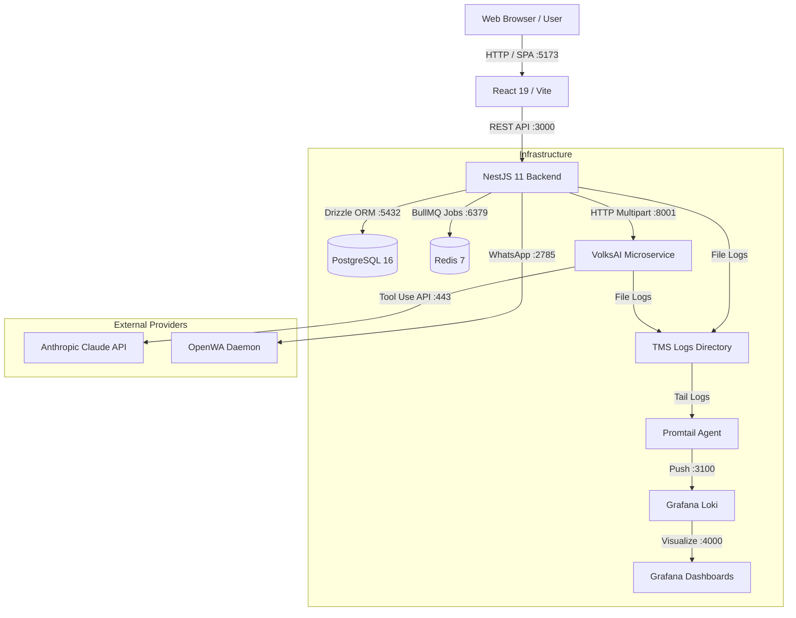

The **Tender Management System (TMS)** is structured as a distributed enterprise monorepo comprising a TypeScript/NestJS backend, a React/Vite single-page application, and an asynchronous Python microservice (**VolksAI**) for document parsing and AI evaluation.

## Service Topology

---

## Network Ports & Protocols

The table below outlines every network service, port, protocol, and health verification command:

| Service | Host Port | Docker Port | Protocol | Purpose | How to Verify |
| :--- | :--- | :--- | :--- | :--- | :--- |
| **`web`** | `5173` | - | HTTP | React 19 Single Page App (Vite Dev Server) | Open `http://localhost:5173` |
| **`api`** | `3000` | `3000` | HTTP | NestJS REST API (`/api/v1`) | `curl http://localhost:3000/api/v1/health` |
| **`volksAi`** | `8001` | `8000` | HTTP | FastAPI PDF Extraction & Checklist Microservice | `curl http://localhost:8001/health` |
| **PostgreSQL** | `5432` | `5432` | TCP | Relational database (125 schemas via Drizzle) | `pg_isready -h localhost -p 5432` |
| **Redis** | `6379` | `6379` | TCP | BullMQ job queue & distributed Lua locks | `redis-cli -h 127.0.0.1 -p 6379 ping` |
| **Grafana** | `4000` | `3000` | HTTP | Observability & token metric dashboards | Open `http://localhost:4000` |
| **Loki** | `3100` | `3100` | HTTP | Centralized log ingestion backend | `curl http://localhost:3100/ready` |
| **OpenWA** | `2785` | `2785` | HTTP | WhatsApp messaging client daemon | `curl http://localhost:2785/health` |

---

## Cross-Service Communication

### 1. Web to Backend API
* **Protocol:** HTTP REST with JSON payloads.
* **Authentication:** Stateless JSON Web Tokens (JWT) passed in `Authorization: Bearer <token>` headers.
* **Vite Proxy:** In development, `vite.config.ts` proxies requests from `/api` directly to `localhost:3000`, bypassing cross-origin restrictions.

### 2. Backend API to VolksAI
* **Protocol:** HTTP POST multipart/form-data.
* **Payload:** The uploaded tender PDF, optional Additional Terms & Conditions (ATC) child PDFs, and Bill of Quantities (BOQ).
* **Timeout:** Managed via `VOLKS_AI_TIMEOUT_MS` (default: 120,000ms / 2 minutes) with Axios HTTP clients.

### 3. Backend API to Redis & PostgreSQL
* **Database Access:** Managed via Drizzle ORM using connection pooling (`pg` driver).
* **Queueing:** BullMQ queues (`pdf-extraction-queue`) serialize high-latency PDF extraction tasks and prevent worker exhaustion.

### 4. VolksAI to Anthropic Claude
* **Protocol:** HTTPS REST with Anthropic SDK.
* **Pattern:** Scoped context windows (`extract_scoped_context`) combined with strict Tool Use schemas to guarantee machine-readable JSON output.
