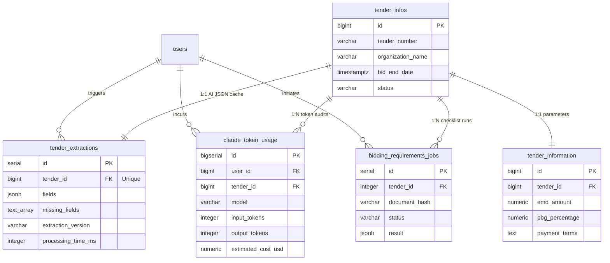

TMS uses **PostgreSQL 16** managed via **Drizzle ORM** (`api/src/db/`). All schemas are defined in TypeScript, providing end-to-end type safety from SQL queries up to the frontend API clients.

## Entity Relationship Topology



<Warning>
  **Table Naming Nuance:**
  * **`tender_infos`** (defined in `tenders.schema.ts`): Stores top-level tender metadata (Tender No, Organization, Due Date, Status, Team).
  * **`tender_information`** (defined in `tender-info-sheet.schema.ts`): Stores deep commercial/technical parameters (EMD, PBG, LD, delivery milestones). In daily conversation, engineers often say "info sheet", but the actual SQL table name is `tender_information`.
</Warning>

---

## Key AI & Extraction Tables

### 1. `tender_extractions` (AI Cache & Raw Payload)
* **Schema File:** `api/src/db/schemas/tendering/tender-extractions.schema.ts`
* **Migration:** `api/drizzle/0137_create_tender_extractions.sql`
* **Purpose:** Durable persistence of the AI extraction JSON. Serves as the primary caching layer for the tendering module.

| Column | Type | Nullable | Default | Description |
| :--- | :--- | :--- | :--- | :--- |
| `id` | `serial` | NO | auto-increment | Primary key |
| `tender_id` | `bigint` | NO | - | Foreign key to `tender_infos.id` (Unique) |
| `fields` | `jsonb` | NO | - | Full extracted JSON payload including values, confidence, and reasoning |
| `missing_fields` | `text[]` | YES | - | Array of field keys not located by Layer 1 or Layer 2 |
| `extraction_version` | `varchar(50)` | YES | `'1.0.0'` | Format: `'1.1.0:<sha256_hash>'` for cache invalidation |
| `processing_time_ms` | `integer` | YES | - | Total roundtrip extraction duration in milliseconds |
| `user_id` | `bigint` | YES | - | User ID of the Tender Executive who initiated extraction |
| `created_at` | `timestamptz` | NO | `now()` | Timestamp of initial extraction |
| `updated_at` | `timestamptz` | NO | `now()` | Timestamp of last update |

---

### 2. `claude_token_usage` (Token Cost Auditing)
* **Schema File:** `api/src/db/schemas/shared/claude-token-usage.schema.ts`
* **Migration:** `api/drizzle/0135_create_claude_token_usage.sql`
* **Purpose:** Financial audit ledger recording every Anthropic API call across all pipelines and users.

| Column | Type | Nullable | Default | Description |
| :--- | :--- | :--- | :--- | :--- |
| `id` | `bigserial` | NO | auto-increment | Primary key |
| `user_id` | `bigint` | YES | - | References `users.id` (ON DELETE SET NULL) |
| `tender_id` | `bigint` | YES | - | Linked tender ID |
| `job_id` | `varchar(100)` | YES | - | Background task or BullMQ identifier |
| `call_type` | `varchar(50)` | NO | `'main_extraction'` | Stage: `'main_extraction'` or `'bidding_requirements'` |
| `model` | `varchar(100)` | NO | `'claude-haiku-4-5-20251001'` | Exact Anthropic model ID invoked |
| `input_tokens` | `integer` | NO | `0` | Prompt tokens sent |
| `output_tokens` | `integer` | NO | `0` | Completion tokens generated |
| `cache_creation_tokens` | `integer` | NO | `0` | Prompt cache write tokens |
| `cache_read_tokens` | `integer` | NO | `0` | Prompt cache hit tokens |
| `total_tokens` | `integer` | NO | `0` | Total combined token count |
| `estimated_cost_usd` | `numeric(10,6)` | NO | `'0'` | USD cost calculated using Anthropic pricing formulas |
| `duration_ms` | `integer` | YES | - | Execution time in milliseconds |

---

### 3. `bidding_requirements_jobs` (Checklist Jobs)
* **Schema File:** `api/src/db/schemas/tendering/bidding-requirements-jobs.schema.ts`
* **Migration:** `api/drizzle/0146_create_bidding_requirements_jobs.sql`
* **Purpose:** Tracks background checklist analysis jobs executed by Role 3.

| Column | Type | Nullable | Default | Description |
| :--- | :--- | :--- | :--- | :--- |
| `id` | `serial` | NO | auto-increment | Primary key |
| `tender_id` | `integer` | NO | - | Linked tender ID |
| `document_hash` | `varchar(64)` | NO | - | SHA-256 hash of the analysed document |
| `status` | `varchar(20)` | NO | `'pending'` | `'pending'` \| `'running'` \| `'done'` \| `'failed'` |
| `result` | `jsonb` | YES | - | Checklist payload (required documents, criteria, annexures) |
| `error_code` | `varchar(50)` | YES | - | Structured error code (e.g. `ANALYSIS_TIMEOUT`) |
| `heartbeat_at` | `timestamptz` | YES | - | Liveness timestamp (jobs older than 60s without beat are dead) |

---

## Sanitized JSON Extraction Example (`fields`)

Below is a representative sample of what is persisted in `tender_extractions.fields`:

<CodeGroup>
```json tender_extractions.fields
{
  "tender_number": "GEM/2026/B/9981245",
  "organization_name": "GAIL (INDIA) LIMITED",
  "tender_value": 45000000.00,
  "bid_end_date": "2026-11-15T15:00:00+05:30",
  "emd_required": "Yes",
  "emd_amount": 900000.00,
  "pbg_required": "Yes",
  "pbg_percentage": 5.0,
  "pbg_duration_months": 18,
  "payment_terms_supply_display": "70% against dispatch, 20% on receipt, 10% on commissioning",
  "payment_terms_supply_reasoning": "SCC Clause 14.1 explicitly supersedes General Terms and specifies three supply milestones.",
  "ld_type_display": "PRS",
  "ld_percentage_per_week": 0.5,
  "max_ld_percentage": 10.0,
  "delivery_time_supply_display": "120 days from PO",
  "technical_eligibility_age": 7,
  "experience_years_display": "7 years prior to bid opening date",
  "maf_required": "Yes",
  "llm_metadata": {
    "role1_called": true,
    "role2_called": true,
    "llm_status": "ok",
    "failed_categories": []
  },
  "biddingRequirementsAnalysis": {
    "schemaVersion": "1.0.0",
    "requiredDocuments": [
      {
        "documentName": "Audited Financial Statements",
        "description": "Balance sheets & P&L for FY 2021-22, 2022-23, 2023-24",
        "pageReference": "Page 14, Clause 3.2"
      }
    ]
  }
}
```
</CodeGroup>

---

## Direct Database Inspection

You can query the database directly using `psql` or Docker CLI:

```bash
# Connect using environment connection string
psql "$DATABASE_URL"

# Or connect via Docker container
docker compose exec postgres psql -U postgres -d tms_db

# Query monthly Claude API token expenditures
SELECT 
    model, 
    call_type, 
    COUNT(*) as total_calls, 
    SUM(total_tokens) as tokens, 
    ROUND(SUM(estimated_cost_usd)::numeric, 4) as cost_usd 
FROM claude_token_usage 
GROUP BY model, call_type;
```
