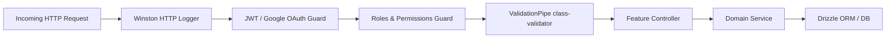

The TMS backend is built with **NestJS 11** and **TypeScript 5.4** (`api/`). It provides a scalable, modular foundation covering procurement workflows, operations, human resources, accounting, and AI document orchestration.

## Core Backend Technologies

* **Framework:** NestJS 11 with Express platform
* **Language:** TypeScript 5.4 with strict mode
* **Database ORM:** Drizzle ORM 0.44 on PostgreSQL 16
* **Background Jobs:** BullMQ 5.66 backed by Redis 7
* **Validation:** Zod-validated configuration modules and `class-validator` DTOs
* **Observability:** Winston rotating file logging, Sentry error tracking, and Prometheus metrics

---

## The 29 Feature Modules

The backend is structured into domain-specific modules imported into `app.module.ts`:

| Domain | Modules Included | Key Responsibilities |
| :--- | :--- | :--- |
| **Tendering** | `tendering`, `checklists`, `info-sheets`, `costing`, `reverse-auctions`, `tq` | Tender ingestion, PDF extraction queues, commercial parameter sheets, document checklists, and reverse auction monitoring. |
| **Operations** | `operations`, `work-orders`, `purchase-orders`, `contracts`, `inventory` | Vendor purchase orders, client work orders, subcontractor agreements, and delivery tracking. |
| **Accounts** | `accounts`, `bank-instruments`, `imprests`, `loans`, `insurance` | Tracking Earnest Money Deposits (EMDs), Performance Bank Guarantees (PBGs), Fixed Deposit Receipts (FDRs), and employee petty cash imprests. |
| **HRMS** | `hrms`, `employees`, `training`, `assets`, `complaints` | Employee records, onboarding documentation, hardware asset assignment, and internal ticketing. |
| **CRM & Sales** | `crm`, `leads`, `follow-ups`, `happy-calling`, `broadcasts` | Client relationship tracking, sales pipeline leads, post-commissioning customer follow-ups, and email/WhatsApp broadcasts. |
| **Services** | `services`, `amc`, `service-visits`, `feedback` | Annual Maintenance Contracts (AMCs), on-site technician visit reports, and client satisfaction surveys. |
| **Master & Shared** | `master`, `auth`, `users`, `roles`, `health`, `notifications` | Shared lookups (32 entities), JWT & Google OAuth authentication, role-based access control, health checks, and OpenWA WhatsApp messaging. |

---

## Request Lifecycle & Guards

### 1. Authentication & Custom Decorators
Authentication is handled via Passport JWT:
* `@Public()`: Marks routes accessible without authentication (e.g. login, health checks).
* `@Permissions(...)`: Requires specific granular permissions on the authenticated user.
* `@Role(...)`: Enforces role-based checks (e.g. `ADMIN`, `TENDER_EXECUTIVE`, `TEAM_LEAD`).
* `@CurrentUser()`: Injects the strongly-typed authenticated user payload into controller methods.

### 2. Validation Pipe
Incoming payloads are automatically validated and transformed using NestJS `ValidationPipe` with `{ whitelist: true, transform: true }`.

### 3. Centralized Exception Filter
The global exception filter catches HTTP and unhandled exceptions, sanitizes sensitive database error details, and records error traces to both `logs/api-error.log` and Sentry.
