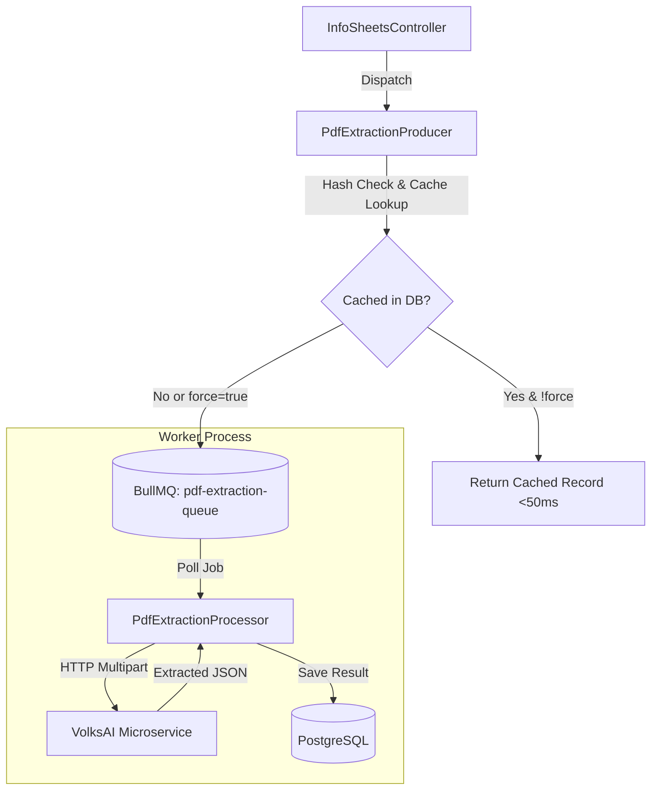

Because processing 400-page tender documents through spatial OCR and Claude LLM fallback takes anywhere from 5 to 60 seconds, PDF extraction is offloaded from the HTTP server to asynchronous background workers using **BullMQ 5.66** and **Redis 7**.

## Queue Topology & Worker Lifecycle



---

## BullMQ Job Producer (`PdfExtractionProducer`)

**File:** `api/src/modules/tendering/info-sheets/pdf-extraction.producer.ts`

When a user requests extraction, the producer executes three defensive checks before enqueuing work:

1. **Document Hashing:** Reads the primary PDF stream to compute a SHA-256 hash (`documentHash`).
2. **PostgreSQL Cache Inspection:** Checks if `tender_extractions` already holds `'1.1.0:' + documentHash`. If found and `force = false`, it returns immediately without queuing a job or calling VolksAI.
3. **Active Job Deduplication:** Queries Redis for active or waiting jobs with the deterministic key `tender-extract-${tenderId}`. If an extraction is already in progress, it returns the active job status rather than launching a duplicate run.

---

## BullMQ Job Processor (`PdfExtractionProcessor`)

**File:** `api/src/modules/tendering/info-sheets/pdf-extraction.processor.ts`

The processor consumes jobs from `pdf-extraction-queue`:

* **File Streaming:** Opens readable file streams from disk for the primary bid PDF, optional ATC child documents, and BOQ files.
* **HTTP Dispatch:** Sends a multipart POST request to `http://localhost:8001/extract` with a 120-second timeout (`VOLKS_AI_TIMEOUT_MS`).
* **Atomic Persistence:**
  * Upserts the extraction payload into `tender_extractions`.
  * Logs API token consumption to `claude_token_usage`.
  * Auto-enqueues checklist analysis if `AUTO_ENQUEUE_CHECKLIST_ANALYSIS=true`.

---

## Starting Dedicated Workers

In production or high-throughput environments, background jobs should be executed in a dedicated worker process separate from the HTTP web server:

```bash
cd api
pnpm start:worker
```

This runs `api/src/worker.ts`, which boots the BullMQ worker processors without starting the HTTP Express listener.

<Info>
  **In-Process Fallback for Local Development:**
  If Redis is temporarily offline or if the dedicated worker process is not started, the API automatically executes extraction tasks in-process as an automatic graceful fallback.
</Info>
