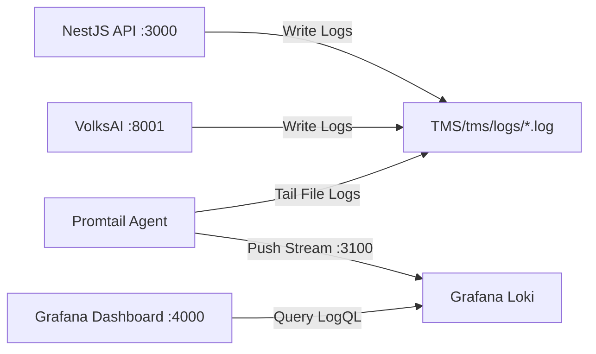

TMS features unified observability across both TypeScript and Python runtimes, combining rotating file logs, centralized log indexing in **Loki**, and visual dashboards in **Grafana**.

## Observability Architecture



---

## Log Destinations & Inspection

### 1. Rotating File Logs (`TMS/tms/logs/`)
Logs are saved on the host machine and rotated daily or upon reaching 20MB:
* `logs/api.log`: NestJS HTTP requests, BullMQ queue events, and database query executions.
* `logs/api-error.log`: Unhandled exceptions, NestJS filter traces, and database connection errors.
* `logs/volksai.log`: PDF extraction breakdowns, OCR page counts, Claude tool inputs, and reasoning outputs.

### 2. Grafana Dashboards (`http://localhost:4000`)
* **URL:** `http://localhost:4000`
* **Default Credentials:** Defined in `docker-compose.yml`.
* **Pre-built Dashboards:** Token expenditure analytics, request latencies, and service error rates.

### 3. LogQL Query Examples in Grafana
You can inspect logs in Grafana Explore using LogQL:

```logql
# Stream all VolksAI extraction logs
{job="volksai"}

# Find all API errors containing database exceptions
{job="api"} |= "ERROR"

# Filter Claude token usage events
{job="volksai"} |= "llm_usage"
```

---

## Health Check Verification Endpoints

Verify service liveness and readiness at any time:

### NestJS Backend API Health Check
```bash
curl -s http://localhost:3000/api/v1/health | jq .
```

```json
{
  "status": "ok",
  "database": "connected",
  "redis": "ready",
  "requiredTables": "verified"
}
```

<Info>
  If core tables (like `tender_extractions`) are missing from PostgreSQL, status returns `"down"` or `"degraded"`.
</Info>

### VolksAI Extraction Microservice Health Check
```bash
curl -s http://localhost:8001/health | jq .
```

```json
{
  "status": "healthy",
  "service": "volksai-extraction",
  "version": "1.0.0",
  "llm_fallback_enabled": true,
  "provider": "anthropic",
  "anthropic_configured": true,
  "paddle_ocr_enabled": true
}
```

<Info>
  If `ANTHROPIC_API_KEY` is not configured, the service reports `"status": "degraded"` with `"anthropic_configured": false`.
</Info>
