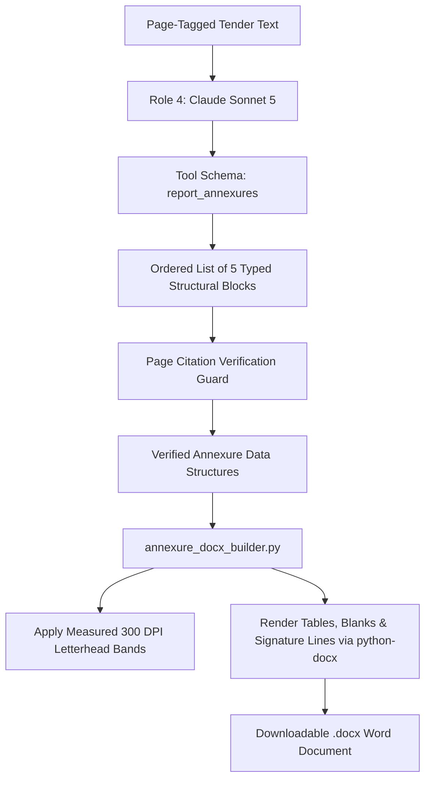

When public tenders require specific legal declarations (e.g. Format F-1 Bid Submission Letter, Format F-2A Bid Security Declaration, or Proforma for Performance Guarantee), bidding engineers traditionally have to retype the form in Microsoft Word.

VolksAI automates this using **Role 4** (`annexure_resolver.py`) paired with a deterministic `.docx` rendering engine (`annexure_docx_builder.py`).

## Annexure Generation Workflow



---

## 1. Role 4: Annexure Identifier & Parser

**File:** `volksAi/app/services/annexure_resolver.py`
* **Model:** `claude-sonnet-5` (configured via `ANTHROPIC_ROLE4_MODEL`)
* **Output Limit:** **16,000 max tokens** (`ROLE_4_MAX_TOKENS`)
* **Tool Schema:** `report_annexures`

### The 5 Typed Structural Blocks
Role 4 parses each detected proforma and breaks it down into an ordered array of five typed blocks:

1. **`heading`:** Section and annexure titles:
   ```json
   { "type": "heading", "text": "ANNEXURE - I: BID SECURITY DECLARATION" }
   ```
2. **`paragraph`:** Legal contractual declarations, undertakings, and body text.
3. **`blank_field`:** Fill-in-the-blank input fields requiring tenderer input:
   ```json
   { "type": "blank_field", "label": "Tender Enquiry No" }
   ```
4. **`table`:** Multi-column grids (e.g. past experience tables, equipment schedules):
   ```json
   { "type": "table", "headers": ["Sl No", "Description", "Qty"], "rows": [["1", "Solar Panels", "500"]] }
   ```
5. **`signature_line`:** Authorized signatory blocks:
   ```json
   { "type": "signature_line", "label": "Name & Signature of Authorized Signatory" }
   ```

---

## 2. Deterministic Word Builder (`annexure_docx_builder.py`)

**File:** `volksAi/app/services/annexure_docx_builder.py`

Once Role 4 outputs the typed blocks, the builder renders a real `.docx` document using `python-docx`. **This builder involves zero LLM calls, zero network requests, and zero randomness**—the same block list always yields the exact same Word file.

### Letterhead Dimensions & Geometry (300 DPI)
Measured from the official Volks Energie letterhead:

| Property | Value (Points) | Value (Inches) | Description |
| :--- | :--- | :--- | :--- |
| **Page Dimensions** | `595.3 pt x 841.9 pt` | `8.27 in x 11.69 in` | Standard International A4 |
| **Header Band Height** | `110.16 pt` | `1.53 in` | 459 px at 300 DPI |
| **Header Gap** | `17.84 pt` | - | Spacing below header image |
| **Top Margin** | `128.0 pt` | `1.78 in` | Sum of header height + gap |
| **Footer Band Height** | `11.28 pt` | - | 47 px at 300 DPI |
| **Footer Distance** | `32.0 pt` | - | Distance from bottom of sheet |
| **Bottom Margin** | `65.0 pt` | `0.90 in` | Distance to body content |
| **Left / Right Margin**| `36.0 pt` | `0.50 in` | Aligns with letterhead logo and contacts |

---

## 3. Fill-in Blanks & XML Sanitation

* **Visible Fill-in Blanks:** For `blank_field` and `signature_line` elements, the builder renders visible fill-in underlines (`"_" * 30`) ready for printing or manual signing.
* **Control Character Sanitation:** XML 1.0 specifications disallow most C0 control characters. The builder sanitizes all text before writing to the Word document, eliminating corrupted `.docx` output.
