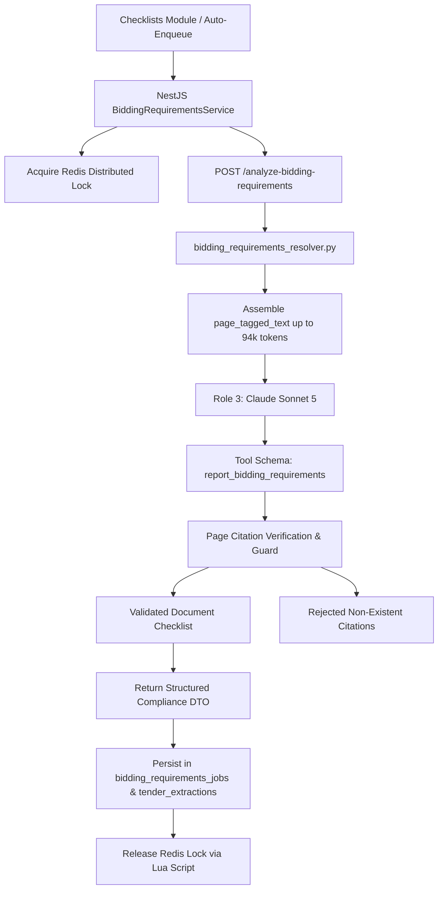

Beyond pre-filling form values, VolksAI features a deep-document compliance analysis pipeline—**`bidding_requirements_resolver.py`**—which identifies every mandatory document, financial statement, and technical certificate required to submit a valid bid.

## Architecture & Execution Model

Unlike field extraction, which uses localized snippets, mandatory compliance documents may appear anywhere across technical specifications, commercial conditions, or annexure pages.



---

## 1. Role 3: Claude Sonnet 5 Configuration

* **Microservice Endpoint:** `POST /analyze-bidding-requirements`
* **Python Module:** `volksAi/app/services/bidding_requirements_resolver.py`
* **Model:** `claude-sonnet-5` (configured via `ANTHROPIC_ROLE3_MODEL`)
* **Context Input:** The unified page-tagged text (`page_tagged_text`, up to ~94,000 tokens) generated by `pdf_parent_ingest.py`.
* **Output Token Budget:** **16,000 max tokens** (`ROLE_3_MAX_TOKENS`).
* **Execution Timeout:** 180 seconds.
* **Cost Accounting:** Averages ~$0.31 USD per execution on complete 200+ page tenders.

---

## 2. Extracted Document Categories

The engine parses the tender and groups required documents into standard compliance categories:

1. **Financial Documents:** Audited balance sheets, Profit & Loss accounts (e.g., FY 2021-24), Working Capital certificates, CA Net Worth certificates.
2. **Technical Eligibility:** Completed work orders with client completion certificates proving required experience.
3. **Statutory & Legal Declarations:** GST registration certificate, PAN card, Power of Attorney (PoA), Non-blacklisting affidavit, Integrity Pact.
4. **Manufacturer Authorizations (MAF):** OEM authorization certificates declaring warranty and spare-parts backing.
5. **Government Policy Declarations:** Make in India (MII) local content percentage certificate and Micro & Small Enterprise (MSE) exemption certificates.

---

## 3. Page Citation Verification Guards

A major risk in LLM document extraction is citing a page number where the clause does not actually appear.

VolksAI enforces strict verification guards on every returned document:
* **Input Check:** Every returned document item must specify a `pageReference` (e.g. `"[Main Page 14]"` or `"[ATC Page 32]"`).
* **Citation Verification:** VolksAI verifies that the referenced page exists in the input document and contains relevant keywords.
* **Rejection List:** Items with missing, malformed, or non-existent page citations are moved to a separate `rejected_documents` array with a logged rejection reason rather than being blindly trusted.

---

## 4. Redis Distributed Locking & In-Flight Memoization

Analyzing a 94k-token document takes 45 to 90 seconds. To prevent concurrent duplicate runs:

1. **Redis Distributed Lock:**
   Acquires a distributed lock before calling VolksAI:
   ```bash
   SET tender:bidding_req:lock:<tenderId> <token> PX 200000 NX
   ```
2. **Lua Release:** The lock is safely released using a Lua script that verifies token ownership.
3. **In-Process Promise Memoization:** If two users view the same tender checklist concurrently, the NestJS process memoizes the active promise and shares the result with both callers.
