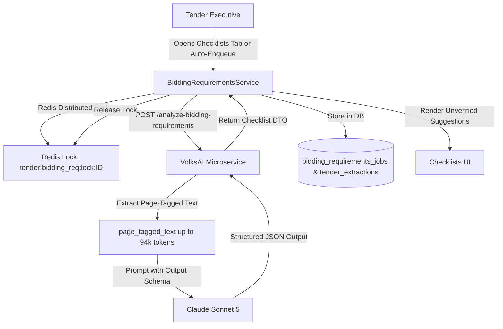

Beyond pre-filling form values, VolksAI features a deep-document analysis engine—**BiddingRequirementsService**—which compiles a checklist of every compliance certificate, financial statement, and legal annexure required to submit a valid bid.

## How Bidding Requirements Analysis Works

Unlike field extraction, which uses scoped snippets, compliance documents may be specified anywhere across technical specifications, commercial conditions, or annexure pages.



---

## Role 3: Claude Sonnet 5 Configuration

* **Backend Service:** `api/src/modules/tendering/checklists/bidding-requirements.service.ts`
* **Microservice Endpoint:** `POST /analyze-bidding-requirements` (in `volksAi/app/routers/bidding_requirements.py`)
* **Model:** `claude-sonnet-5` (or `claude-sonnet-5-5`)
* **Context Input:** Ingests the complete page-tagged text of the tender (`page_tagged_text`), up to ~94,000 tokens.
* **Token Budget & Timeout:**
  * Maximum Output Tokens: **16,000**
  * Execution Timeout: **180 seconds** (`BIDDING_REQUIREMENTS_MIN_TIMEOUT_MS`)
  * Typical Cost per Analysis: ~$0.31 USD on full tenders

---

## Extracted Document Categories

The model categorizes every required document into standard bidding groups:

1. **Financial Documents:** Audited balance sheets, Profit & Loss accounts (e.g. FY 2021-24), Working Capital certificates, CA Net Worth certificates.
2. **Technical Eligibility:** Completed work orders with client completion certificates proving required experience.
3. **Statutory & Legal Declarations:** GST registration certificate, PAN card, Power of Attorney (PoA), Non-blacklisting affidavit, Integrity Pact.
4. **Manufacturer Authorizations (MAF):** OEM authorization certificates declaring warranty and spare-parts backing.
5. **Government Policy Declarations:** Make in India (MII) local content percentage certificate and Micro & Small Enterprise (MSE) exemption certificates.

---

## Concurrency & Redis Distributed Locking

Because analyzing a 94k-token document takes 45 to 90 seconds, concurrent requests for the same tender must be coordinated:

1. **Distributed Redis Lock:**
   Before calling VolksAI, `BiddingRequirementsService` acquires a distributed lock in Redis:
   ```bash
   SET tender:bidding_req:lock:<tenderId> <token> PX 200000 NX
   ```
2. **Lua Script Release:** The lock is safely released using a Lua script that verifies token ownership, preventing accidental release if execution exceeds the TTL.
3. **In-Process Promise Memoization:** If multiple users open the same tender checklist concurrently, the NestJS process memoizes the active promise and shares the result with both callers.

---

## Caching & Auto-Enqueueing

* **Storage:** Results are persisted in the `bidding_requirements_jobs` table keyed by `(tender_id, document_hash)`.
* **Redundant Field Cache:** The checklist payload is also saved inside `tender_extractions.fields.biddingRequirementsAnalysis` (added in commit `53585e45`) so the main tender record contains all AI outputs in a single JSON document.
* **Auto-Enqueue:** When `AUTO_ENQUEUE_CHECKLIST_ANALYSIS=true` is set in the API environment, completing an info-sheet extraction automatically queues checklist analysis in the background.

---

## Frontend Checklist UX Safeguards

* **Unverified Suggestions (Commit `a0ffabb6`):** Extracted documents are presented in the UI as *suggestions with a document preview* rather than pre-checking them. This prevents Tender Executives from submitting unverified checklists to clients.
* **State Machine (Commit `06f10f10`):** The UI cleanly handles 4 discrete states:
  * `not_analysed`: Clean prompt with an "Analyze Checklist" button
  * `in_progress`: Animated progress spinner with heartbeat monitoring
  * `failed`: Structured error code with a one-click retry button
  * `completed`: Categorized checklist with page citations and annexure downloads
