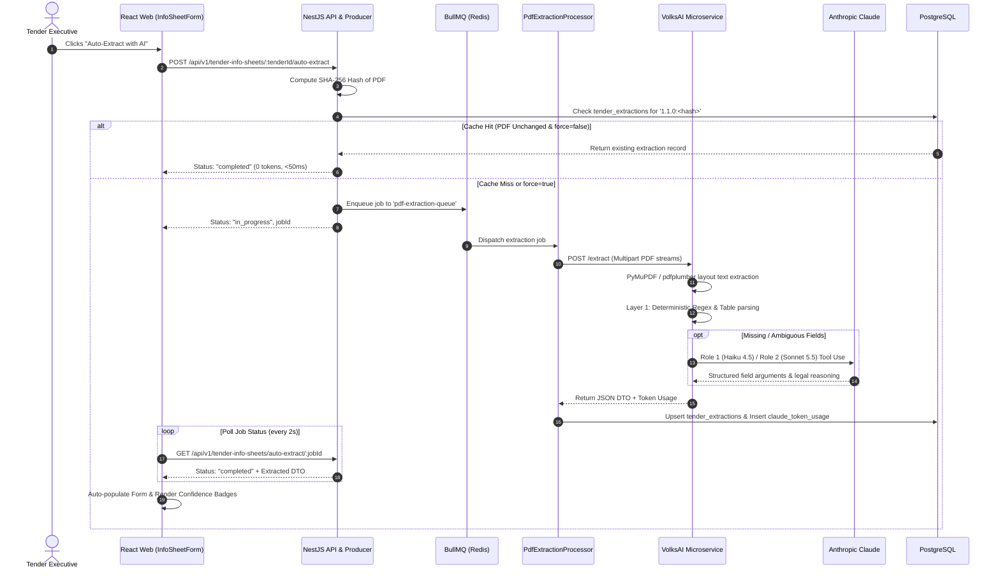

<div className="p-4 rounded-xl border border-orange-500/20 bg-orange-500/5 mb-6">
  <div className="text-sm text-gray-700 dark:text-gray-300">
    <p><strong>Document Type:</strong> VolksAI Developer Onboarding & System Architecture Reference</p>
    <p><strong>Audience:</strong> Junior Developers, Interns, and Incoming AI/Backend Engineers</p>
    <p><strong>Target Subsystem:</strong> <code>volksAi/</code> & Tendering PDF Pipeline</p>
    <p><strong>Last Updated:</strong> October 2026</p>
    <p className="m-0"><strong>Confidentiality Notice:</strong> No secret keys, passwords, or credentials are contained in this document. All credentials are referenced strictly by environment variable names.</p>
  </div>
</div>

---

## 1. What This Project Is

### 1.1 The Real-World Problem
Imagine walking into a library every morning and being handed three stacks of legal papers, each between 50 and 400 pages long. Each stack represents an Indian Government or Public Sector Undertaking (PSU) **tender**—an open invitation by a government entity (like GAIL, IOCL, NTPC, or the Indian Railways) asking private companies to bid on contracts for engineering, solar installations, equipment procurement, or infrastructure projects.

To bid on these tenders, our company—**Volks Energie Pvt. Ltd. (VEPL)**—must read through hundreds of pages of dense legal and technical clauses before a strict deadline. A human bidding engineer, known as a **Tender Executive (TE)**, historically had to comb through every page looking for critical answers:
* How much money must we deposit up front just to bid? (Earnest Money Deposit or **EMD**)
* What percentage of the order value do we lose if delivery is delayed by a week? (Liquidated Damages / Price Reduction Schedule or **LD / PRS**)
* What percentage must we guarantee via a bank if we win? (Performance Bank Guarantee or **PBG**)
* What specific payment milestones apply? (e.g., 70% on material delivery, 20% on installation, 10% on commissioning)
* What previous work experience must we prove? (e.g., 3 completed orders of ₹1 Crore in the last 7 years)

Missing a single sentence buried on page 183 of an Additional Terms & Conditions (ATC) document could mean forfeiting a ₹50,00,000 bank guarantee or being disqualified from bidding after spending weeks on technical drawings. Doing this manually takes a Tender Executive 4 to 8 hours per tender, limits the number of tenders the company can bid on, and risks human error.

### 1.2 Who Uses This System
1. **Tender Executives (TEs):** Bidding engineers who review incoming tenders, evaluate whether our company qualifies, fill out technical sheets, prepare checklists of mandatory documents, and prepare price bids.
2. **Team Leaders (TLs) / Tender Approvers:** Senior managers who review the TE's findings, verify risks, and approve or reject proceeding with a bid.
3. **Operations & Finance Teams:** Project managers, accountants, and procurement officers who handle vendor work orders, purchase orders, client billings, bank guarantees, and cash flow tracking once a bid is won.

### 1.3 The Core Solution: TMS + VolksAI
The **Tender Management System (TMS)** is a complete enterprise web application paired with an intelligent extraction microservice called **VolksAI**.

When a Tender Executive uploads tender documents to the system:
1. **Inputs:**
   * **Primary Bid Document:** Typically a standardized PDF from the **GeM** (Government e-Marketplace) portal or a PSU e-procurement site.
   * **Additional Terms and Conditions (ATC) / Scope of Work (SOW):** A secondary PDF containing custom clauses, special conditions of contract (SCC), technical specifications, and delivery milestones.
   * **Bill of Quantities (BOQ):** Equipment quantities and line-item schedules.
2. **Processing:**
   * VolksAI first scans the PDF text and uses fast, deterministic rule-based algorithms (regular expressions and spatial layout parsing) to extract known standard tables (Layer 1).
   * If critical fields are missing, ambiguous, or buried in non-standard paragraphs, VolksAI invokes Anthropic Claude LLMs using tightly scoped snippets (Layer 2) to resolve the exact legal wording without hallucination.
3. **Outputs:**
   * **Tender Information Sheet (Info Sheet):** A comprehensive structured record pre-filling commercial, financial, and technical parameters in the UI form. Every AI-extracted field is tagged with an audit trail, confidence badge, and review flag.
   * **Bidding Requirements Checklist:** An AI-generated, comprehensive list of every mandatory document required by the tender (balance sheets, OEM authorization certificates, ISO certificates, joint venture agreements), paired with ready-to-download Word (`.docx`) annexure templates.

In short: **TMS and VolksAI turn hundreds of pages of complex, messy government procurement PDFs into structured, verified, actionable data in under 60 seconds.**

---

## 2. VolksAI Architecture & Repo Map

### 2.1 VolksAI Subsystem Structure
```
volksAi/
├── app/
│   ├── main.py                     # FastAPI entrypoint, middleware, CORS, lifespan startup
│   ├── routers/
│   │   ├── extract.py              # POST /extract (Tender PDF ingestion & field extraction)
│   │   ├── bidding_requirements.py # POST /analyze-bidding-requirements (Checklists)
│   │   └── health.py               # GET /health (Microservice & Claude readiness)
│   ├── services/
│   │   ├── pdf_parent_ingest.py    # PyMuPDF/pdfplumber parser and PaddleOCR coordinator
│   │   ├── tender_mapper.py        # Layer 1 deterministic regex mapping
│   │   ├── field_extractor.py      # Spatial table and text parser
│   │   ├── llm_field_resolver.py   # Layer 2 Claude resolver (Role 1 Haiku & Role 2 Sonnet)
│   │   └── tms_field_mapper.py     # Maps Python dicts to camelCase NestJS DTOs
│   └── core/
│       ├── config.py               # Environment configuration settings
│       └── logging.py              # Rotating file logger writing to logs/volksai.log
├── scratch/                        # Diagnostic scripts and test fixtures
│   ├── check_models.py             # Minimal Claude connectivity test
│   ├── check_scc_payment.py        # SCC payment term regression checks
│   ├── find_cps_pages.py           # Contract Performance Security page finder
│   └── verify_ground_truth.py      # Ground-truth regression verification
├── Dockerfile                      # Container definition with PyMuPDF and PaddleOCR
└── requirements.txt                # Python dependencies
```

### 2.2 Network Ports & Protocols

| Service | Host Port | Container Port | Protocol | Purpose | How to Verify |
| :--- | :--- | :--- | :--- | :--- | :--- |
| **`volksAi`** | `8001` | `8000` | HTTP | FastAPI PDF extraction & checklist service | `curl http://localhost:8001/health` |
| **`api`** | `3000` | `3000` | HTTP | NestJS REST API (`/api/v1`) | `curl http://localhost:3000/api/v1/health` |
| **`web`** | `5173` | - | HTTP | React 19 Frontend (Vite dev server) | Open `http://localhost:5173` |
| **PostgreSQL**| `5432` | `5432` | TCP | Relational database (stores `tender_extractions`) | `pg_isready -h localhost -p 5432` |
| **Redis** | `6379` | `6379` | TCP | BullMQ job queue & distributed locks | `redis-cli -h 127.0.0.1 -p 6379 ping` |

---

## 3. End-to-End Extraction Pipeline



---

## 4. The Claude / AI Engine in VolksAI

### 4.1 LLM Roles Breakdown
* **Role 1 (`claude-haiku-4-5-20251001`):** Fast extraction of missing fields (`pbg_sd`, `payment_terms`, `prs_ld`, `bec_criteria`) using Anthropic Tool Use. Output ceiling: 600 max tokens (+1 retry at 1,000).
* **Role 2 (`claude-sonnet-5-5`):** Resolves ambiguous clauses when general terms contradict special conditions (e.g. delivery or payment milestones), producing mandatory legal reasoning.
* **Role 3 (`claude-sonnet-5`):** Analyzes full page-tagged tender text (up to ~94k tokens) in `BiddingRequirementsService` to extract mandatory document checklists.

### 4.2 Why We Never Send 200 Pages to Claude
1. **Cost:** Feeding ~100k tokens per call costs over $0.30 on Haiku and $1.50+ on Sonnet.
2. **Latency:** Processing 100k tokens takes 25 to 60 seconds per call.
3. **Accuracy Degradation ("Lost in the Middle"):** Large context windows suffer from attention dilution. Models frequently overlook a 3-line clause on page 140 when buried in 200 pages of boilerplate.

#### How Scoped Context Works (`extract_scoped_context`)
* Regex scans for explicit section titles (e.g. `SECTION V: SPECIAL CONDITIONS OF CONTRACT`, `PAYMENT TERMS`).
* It extracts a localized window (500 to 2,500 characters) surrounding the matched clause.
* **Strict Section Matching:** If no relevant section heading is found, the system immediately returns `not_found` with **zero LLM calls**.

---

## 5. Caching & Cost Accounting

1. **SHA-256 PDF Hash Caching:**
   * When a PDF is received, `PdfExtractionProducer.computeDocumentHash()` computes its SHA-256 hash.
   * Version format: `'1.1.0:' + documentHash`.
   * On subsequent calls without `force: true`, PostgreSQL `tender_extractions` returns the cached record immediately (**0 tokens, less than 50ms**).
2. **Token Accounting (`claude_token_usage`):**
   * Records model, input tokens, output tokens, prompt cache creation tokens, prompt cache read tokens, and calculated USD costs.
   * Accessible via Grafana dashboard at `http://localhost:4000`.

---

## 6. How to Run, Test and Debug VolksAI

### 6.1 Local Python Environment Setup
```bash
cd volksAi
python -m venv .venv

# On Windows:
.venv\Scripts\activate
# On Linux / macOS:
source .venv/bin/activate

pip install -r requirements.txt
uvicorn app.main:app --host 0.0.0.0 --port 8000 --reload
```

### 6.2 Testing Claude Connectivity
Verify that VolksAI can invoke Anthropic models with a minimal ping:
```bash
cd volksAi
python scratch/check_models.py
```

### 6.3 Direct Microservice Invocation (curl)
```bash
curl -X POST "http://localhost:8001/extract" \
  -F "pdf_file=@/path/to/Bid_Document.pdf" \
  -F "user_id=1" \
  -F "tender_id=123" \
  -o extraction_result.json
```

---

## 7. Known Bugs & Ground-Truth Regressions

1. **Phone Number Whitespace (`clean_phone()`):**
   * *File:* `volksAi/app/services/tender_mapper.py`
   * *Problem:* Inserts spaces around slashes (` / `), while tests assert compact slashes (`/`).
   * *Fix:* Add `phone = re.sub(r'\s*/\s*', '/', phone)`.
2. **Kochi GAIL Tender Second Officer (`client_name_2_display`):**
   * *File:* `volksAi/app/services/field_extractor.py`
   * *Problem:* Overly rigid row splitting in `_parse_officer_table()` misses Sabu Mathews on multi-line rows.
   * *Fix:* Split rows on designated officer keywords (`General Manager`, `DGM`, `Manager`, `Engineer`).
3. **Scanned PDF Text Density Check:**
   * *File:* `volksAi/app/services/pdf_parent_ingest.py`
   * *Problem:* Checks page 1 text density only. If page 1 is a digital cover but pages 2-50 are scanned images, OCR is not triggered.
   * *Fix:* Check average character density across the first 5 pages (`chars_per_page < 50`).

---

## 8. Prioritized Developer TODOs (VolksAI Roadmap)

* **P1 (0.5 hrs):** Fix phone whitespace in `clean_phone()`.
* **P2 (1 hr):** Fix Kochi officer ground-truth regression in `_parse_officer_table()`.
* **P4 (2 hrs):** Update synthetic test fixtures in `test_role1_prompt_examples.py` with section headers.
* **P5 (4 hrs):** Implement 5-page average character density check for PaddleOCR fallback.
* **P6 (2 hrs):** Invalidate cache when model or prompt version changes in `PdfExtractionProducer`.
* **P7 (2-3 days):** Create unified `POST /extract-all` endpoint merging field extraction and checklist analysis.
