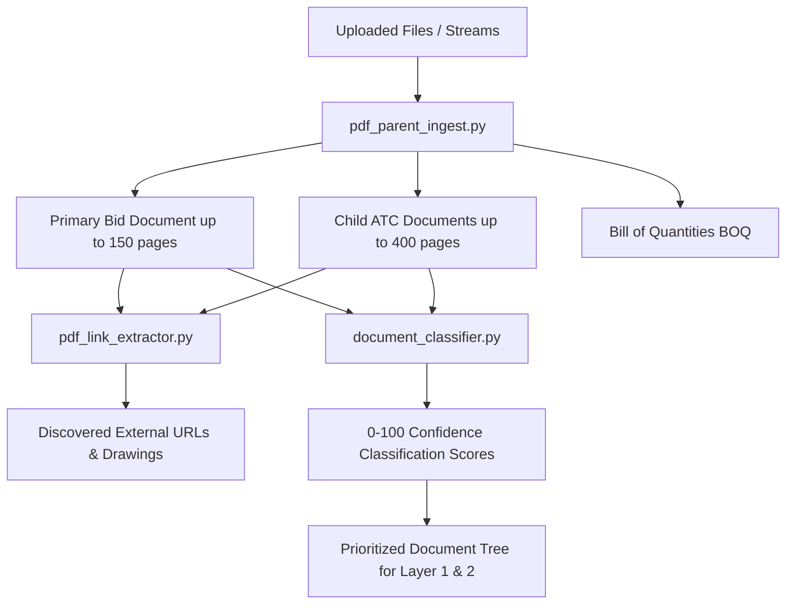

A tender package rarely arrives as a single file. An Indian PSU tender typically consists of a primary GeM bid summary PDF, multiple Additional Terms & Conditions (ATC) attachments, technical drawing schedules, and Bill of Quantities (BOQ) files.

## Document Ingestion Architecture



---

## 1. Primary PDF Ingestion (`pdf_parent_ingest.py`)

**File:** `volksAi/app/services/pdf_parent_ingest.py`

* **Page Limits:**
  * Primary GeM bid PDF: Ingests up to **150 pages** (`MAIN_TENDER_MAX_PAGES`).
  * Child ATC documents: Ingests up to **400 pages** (`CHILD_PDF_MAX_PAGES`, raised from 60 in commit `aee316ab`).
* **Text & Layout Stream:** Uses PyMuPDF (`fitz`) for raw text and layout coordinates, paired with `pdfplumber` for structured tabular grids.
* **Page-Tagged Text Assembly (`build_page_tagged_text`):** Generates a unified text stream prefixing each page with a standard delimiter:
  ```
  [Main Page 1]:
  ...content...
  [ATC Page 42]:
  ...special conditions...
  ```
  This tagged format allows downstream LLM roles (Role 3 and Role 4) to cite exact source pages with zero ambiguity.

---

## 2. External Link Extraction (`pdf_link_extractor.py`)

**File:** `volksAi/app/services/pdf_link_extractor.py`

In Indian public procurement, buyers often embed external URLs inside the PDF to point to:
* High-resolution technical CAD drawings and single-line diagrams
* Buyer-uploaded ATC zip files hosted on external servers
* Corrigendum notices and pre-bid meeting clarifications

The extractor:
1. Iterates over PDF link annotations (`page.get_links()`).
2. Extracts HTTP/HTTPS URIs and anchor text bounding boxes.
3. Filters out generic government portal navigation links (`gem.gov.in/help`, `india.gov.in`).
4. Associates external URLs with the specific tender section they reference.

---

## 3. Deterministic Document Classification (`document_classifier.py`)

**File:** `volksAi/app/services/document_classifier.py`

To prevent irrelevant files (such as 100-page generic environmental policies or standard MSE procurement guidelines) from diluting the extraction engine, `document_classifier.py` computes a **0 to 100 confidence score** indicating whether a document is an actionable ATC contract:

```python
# Confidence score tiers in document_classifier.py
ATC_CONFIDENCE_HIGH_PRIORITY = 95.0
ATC_CONFIDENCE_GENERAL_FALLBACK = 60.0
ATC_CONFIDENCE_SELF_TEXT_MATCH = 75.0
ATC_CONFIDENCE_SELF_FILENAME_MATCH = 70.0
ATC_CONFIDENCE_WEAK_ANY_PDF = 15.0
ATC_CONFIDENCE_NONE = 0.0
```

### Signal Keyword Sets

1. **High-Priority Keywords (Score 95.0):**
   * Words: `atc`, `tendoc`, `buyer1`, `buyer_uploaded`
2. **Exclusion Terms (Immediate Score 0.0):**
   * Words: `mse`, `mii`, `gtc`, `rules`, `list-of-categories`, `catalog`, `specification`, `spec`, `drawing`, `schedule`, `boq`
   * *Rationale:* Generic Make-In-India (MII) or General Terms (GTC) circulars must not override tender-specific Special Conditions.
3. **Full-Text In-Document Keywords (Score 75.0):**
   * Phrases: `"bidding data sheet"`, `"special conditions of contract"`, `"buyer added bid specific atc"`, `"price reduction schedule"`, `"terms of payment"`
