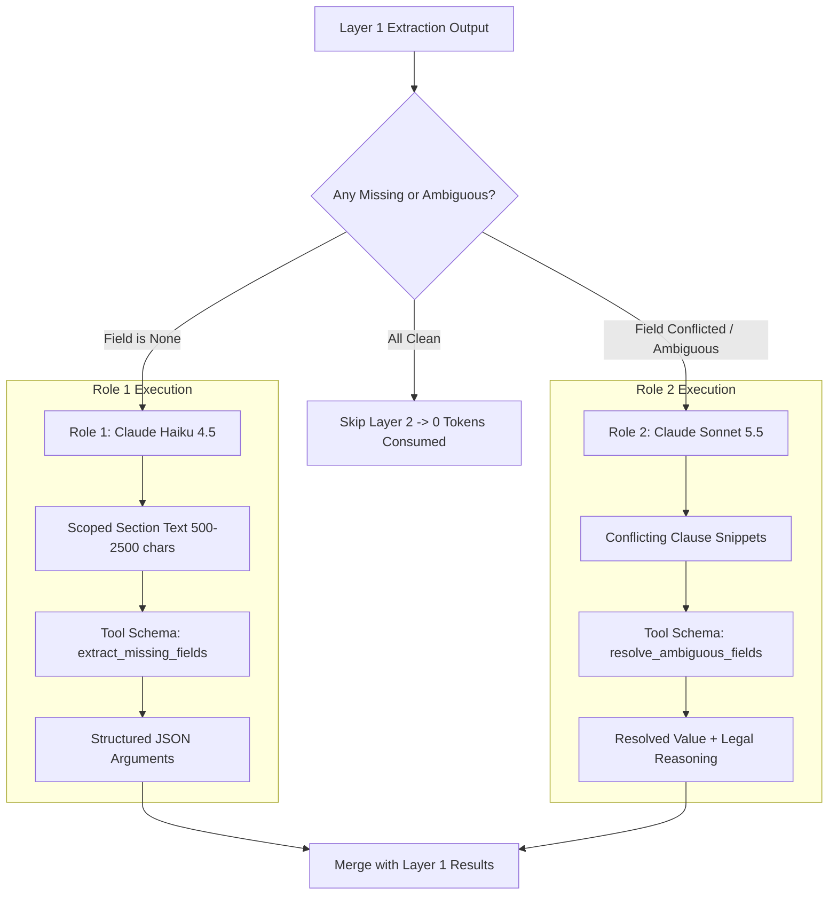

When Layer 1 fails to find critical tender parameters or encounters contradictory clauses, execution transitions to **`llm_field_resolver.py`** (111 KB). This module coordinates Anthropic Claude models using strict schema-constrained Tool Use.

## Architecture of LLM Roles

VolksAI decouples extraction tasks into specialized model personas:



---

## 1. Role 1: Haiku 4.5 for Missing Field Extraction

**Function:** `resolve_missing_fields_role1()`

Role 1 operates on missing fields grouped into logical batches to minimize HTTP latency and API overhead:

| Category Key | Fields Extracted | Typical Source Section |
| :--- | :--- | :--- |
| `pbg_sd` | `pbg_percentage`, `pbg_duration_months`, `pbg_instruments` | Special Conditions of Contract (SCC), Bid Security |
| `payment_terms` | `payment_terms_supply`, `payment_terms_installation` | Terms of Payment, Milestone Schedule |
| `prs_ld` | `ld_percentage_per_week`, `max_ld_percentage` | Liquidated Damages, Price Reduction Schedule |
| `bec_criteria` | `experience_years`, `annual_turnover_amount`, `jv_allowed` | Bidder Eligibility Criteria (BEC / PQR) |
| `delivery_timeline`| `delivery_time_supply_display`, `delivery_time_installation` | Scope of Work, Delivery Schedule |
| `contacts_bds` | `client_name_1_display`, `client_email_1_display`, `client_phone_1`| Bid Data Sheet (BDS), Nodal Officer Info |

### The Anthropic Tool Use Schema
Haiku is forced to use the `extract_missing_fields` tool. It is given a strict JSON schema and prohibited from producing conversational text:

```json
{
  "name": "extract_missing_fields",
  "description": "Extract missing tender parameters from provided legal clauses",
  "input_schema": {
    "type": "object",
    "properties": {
      "pbg_percentage": { "type": "number", "description": "ePBG percentage of contract value" },
      "pbg_duration_months": { "type": "integer", "description": "Validity in months" },
      "ld_percentage_per_week": { "type": "number", "description": "Penalty rate per week of delay" },
      "clause_excerpt": { "type": "string", "description": "Exact verbatim excerpt from tender text" }
    },
    "required": ["clause_excerpt"]
  }
}
```

---

## 2. Role 2: Sonnet 5.5 for Ambiguity Resolution

**Function:** `resolve_ambiguous_fields_role2()`

In many tenders, Layer 1 regex will find *multiple* contradictory mentions. For example, the GeM General Terms might state *"Delivery: 90 days"*, but page 42 of the Special Conditions of Contract (SCC) states *"Supply within 120 days, Installation within 30 days from site handover"*.

1. Layer 1 flags this field as `ambiguous: true`.
2. **Role 2** evaluates the clauses against legal contract hierarchy (SCC legally supersedes GCC in Indian procurement).
3. Sonnet emits both the resolved string and a mandatory legal reasoning field:
   ```json
   {
     "payment_terms_supply_display": "70% against dispatch, 20% on receipt, 10% on commissioning",
     "payment_terms_supply_reasoning": "SCC Clause 14.1 explicitly supersedes General Terms and specifies three supply milestones."
   }
   ```

---

## 3. Token Budgeting & Resilience

* **Token Limit & Truncation Retries:** Role 1 is bounded by a default ceiling of **600 tokens**. If output is truncated (`stop_reason == "max_tokens"`), a single automatic retry is executed with **1,000 tokens**.
* **Error Classification (`classify_anthropic_error`):** Transients (timeouts, 429 rate limits) trigger retries, while 401 authentication errors return a structured failure dictionary without crashing the process.
* **Pricing & Cost Accounting:** Computes exact USD costs using Anthropic pricing formulas, accounting for input, output, and prompt cache hit/write tokens.
