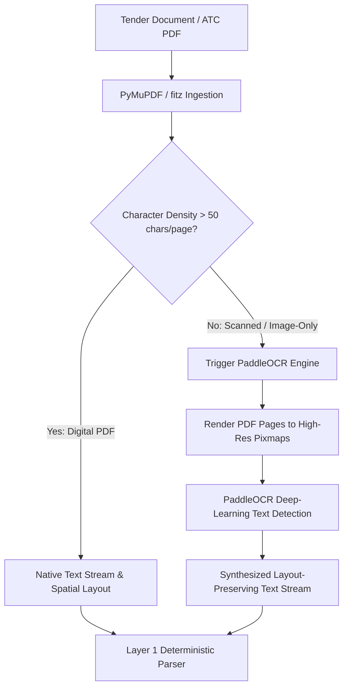

A major challenge in Indian Government and PSU procurement is document heterogeneity. While primary GeM bid documents are digitally generated PDFs, buyers (such as State Electricity Boards, Municipal Corporations, or GAIL regional offices) frequently scan physical paper circulars, stamp them with ink, and append them as the Additional Terms & Conditions (ATC) PDF.

## Ingestion Pipeline: Digital vs. Scanned



---

## The OCR Engines: PaddleOCR vs. Tesseract

VolksAI includes support for both **PaddleOCR** and **Tesseract**, with PaddleOCR configured as the default:

* **PaddleOCR (`PADDLE_OCR_ENABLED=true`):** Uses lightweight deep learning models (DBNet for text detection and CRNN for text recognition). Exceptionally robust with skewed scans, noisy backgrounds, and low-contrast paper circulars common in PSU tenders.
* **Tesseract Fallback:** Available when PaddleOCR is disabled or when running in resource-constrained environments.

---

## Memory & CPU Resource Management

Deep-learning OCR engines can saturate multi-core CPUs and consume significant RAM:

1. **CPU Thread Limiting (`OMP_NUM_THREADS=1`):**
   In `volksAi/app/core/config.py` and the container environment, `OMP_NUM_THREADS=1` is enforced. This restricts OpenMP threads in native C++ libraries, preventing OCR from monopolizing all host CPU cores during concurrent user requests.
2. **RAM Requirements:**
   Running PaddleOCR requires at least **2GB to 4GB of dedicated RAM** inside Docker. If memory is exhausted, Linux will terminate the worker with an `OOMKilled` (Out of Memory) signal.

---

## Scanned PDF Edge Cases & Mitigations

### 1. The "Digital Cover with Scanned Inserts" Gotcha (Issue 7)
* **Problem:** In some PSU tenders, page 1 is a digitally added cover sheet with crisp vector text, but pages 2 through 50 are photocopied scans.
* **Current Limitation:** A single-page text check on page 1 will incorrectly assume the entire document is digital and bypass OCR, resulting in empty text for pages 2-50.
* **Recommended Mitigation (P5 Roadmap):**
  Check average character density across the first 5 pages (`chars_per_page < 50`). If low, switch to PaddleOCR for the entire document:

```python
# volksAi/app/services/pdf_parent_ingest.py
def should_trigger_ocr(doc: fitz.Document, sample_pages: int = 5) -> bool:
    total_chars = 0
    pages_checked = min(sample_pages, len(doc))
    for i in range(pages_checked):
        total_chars += len(doc[i].get_text().strip())
    avg_chars = total_chars / max(1, pages_checked)
    return avg_chars < 50
```

### 2. Multi-Lingual & Vernacular OCR
State tenders in regional Indian languages (e.g. Hindi, Tamil, Marathi) are currently **out-of-scope** for the MVP. English-language tenders and bilingual formats (where English is present alongside Hindi) are supported.
