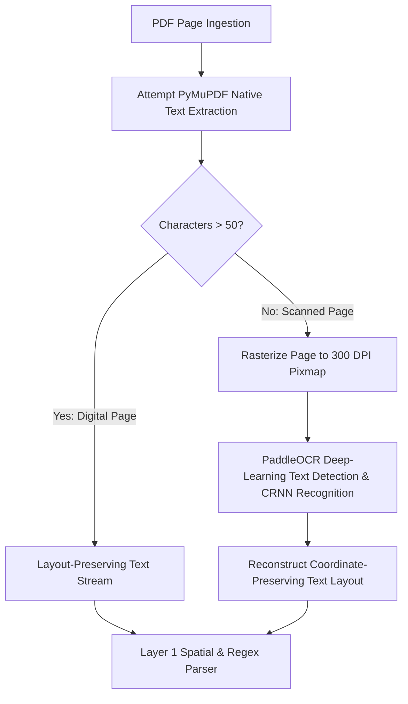

A major engineering challenge in Indian procurement is document heterogeneity. While primary GeM bid documents are digitally generated PDFs, buyers frequently scan physical paper circulars, stamp them with ink, and append them as the Additional Terms & Conditions (ATC) PDF.

## Optical Recognition Architecture



---

## 1. PaddleOCR vs. Tesseract

VolksAI defaults to **PaddleOCR** (`PADDLE_OCR_ENABLED=true`):

* **PaddleOCR:**
  * Uses **DBNet** (Real-time Scene Text Detection) for locating text bounding boxes.
  * Uses **CRNN** (Convolutional Recurrent Neural Network) with CTC loss for sequence recognition.
  * Exceptionally resilient with skewed scans, curved text lines, photocopier noise, and low-contrast paper documents.
* **Tesseract:**
  * Kept as a lightweight fallback when PaddleOCR is disabled via environment variables.

---

## 2. Resource Management: CPU Throttling & RAM Limits

Deep-learning OCR engines can easily saturate multi-core server CPUs and consume gigabytes of memory:

### CPU Core Throttling (`OMP_NUM_THREADS=1`)
In `volksAi/app/core/config.py` and the container environment, `OMP_NUM_THREADS=1` is strictly enforced. This restricts OpenMP threads in native C++ libraries (such as OpenCV and Paddle Inference), preventing OCR from starving the FastAPI event loop during concurrent requests.

### RAM Sizing & OOM Guards
Running PaddleOCR requires at least **2GB to 4GB of dedicated RAM** inside Docker. If memory is exhausted, the Linux kernel terminates the worker with an `OOMKilled` signal.

---

## 3. Scanned PDF Edge Cases

### The "Digital Cover with Scanned Inserts" Gotcha (Issue 7)
* **The Problem:** In some PSU tenders, page 1 is a digitally created cover sheet with crisp vector text, but pages 2 through 50 are photocopied scans.
* **The Vulnerability:** If the parser checks character density on page 1 alone, it incorrectly assumes the entire document is digital and skips OCR, leaving pages 2 through 50 blank.
* **The Solution (P5 Roadmap):**
  Check the average character density across the first 5 pages (`chars_per_page < 50`). If low, switch to PaddleOCR for the entire document:

```python
# volksAi/app/services/pdf_parent_ingest.py
def should_trigger_ocr(doc: fitz.Document, sample_pages: int = 5) -> bool:
    total_chars = 0
    pages_checked = min(sample_pages, len(doc))
    for i in range(pages_checked):
        total_chars += len(doc[i].get_text().strip())
    avg_chars = total_chars / max(1, pages_checked)
    return avg_chars < 50
```
