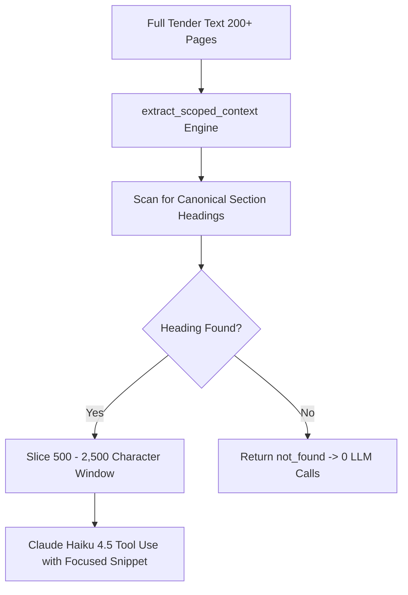

A foundational principle of VolksAI's architecture is **Scoped Context Windowing** (`extract_scoped_context`). Government tender PDFs can reach 400 pages of legal boilerplate, arbitration clauses, and safety guidelines that are completely irrelevant to financial evaluation.

## Why We Never Send 200 Pages to Claude

Feeding an entire 200+ page PDF to an LLM for field extraction introduces three critical failure modes:

1. **High Token Costs:** Passing ~100,000 tokens per call costs over $0.30 on Haiku and $1.50+ on Sonnet. With multiple extraction attempts, costs escalate exponentially.
2. **Excessive Latency:** Processing a 100k-token prompt takes 25 to 60 seconds per API invocation.
3. **Accuracy Dilution ("Lost in the Middle"):** Large context windows suffer from attention degradation. Models frequently overlook a 3-line payment clause on page 142 when buried inside 200 pages of text.

---

## How Scoped Context Extraction Works

**File:** `volksAi/app/services/llm_field_resolver.py` (`extract_scoped_context`)

For each field category, regular expressions search for explicit contractual section headers:

### Canonical Section Headings by Category

* **`pbg_sd` (Security Deposit / PBG):**
  * `SECTION - V: SPECIAL CONDITIONS OF CONTRACT`
  * `CONTRACT PERFORMANCE SECURITY`
  * `SECURITY DEPOSIT / PERFORMANCE GUARANTEE`
* **`payment_terms`:**
  * `TERMS OF PAYMENT`
  * `SCHEDULE OF PAYMENTS`
  * `PAYMENT MILESTONES`
* **`prs_ld` (Liquidated Damages):**
  * `PRICE REDUCTION SCHEDULE`
  * `LIQUIDATED DAMAGES`
  * `COMPENSATION FOR DELAY`
* **`bec_criteria` (Bidder Eligibility):**
  * `SECTION - II: BID EVALUATION CRITERIA`
  * `PRE-QUALIFICATION CRITERIA (PQC)`
  * `TECHNICAL ELIGIBILITY`

Once a heading is detected, VolksAI slices a localized window (typically **500 to 2,500 characters**) surrounding the matched section.

---

## Elimination of the Blind Fallback (Commit `aee316ab`)

In early versions of VolksAI, if no section heading was found, the system had a blind fallback that sent the first 6,000 characters of the document to Claude.
* **The Problem:** The first 6,000 characters of a PSU tender almost always contain generic preamble text, portal instructions, or table of contents lists—never the actual commercial clauses. This wasted tokens and occasionally caused the model to hallucinate.
* **The Fix:** The blind fallback was completely eliminated in commit `aee316ab`. If no relevant section heading is detected, VolksAI immediately emits `not_found` with **zero LLM calls**.

---

## Prompt Engineering & Tool Constraints

To guarantee deterministic, machine-readable JSON output:

1. **System Instructions:** Claude is instructed that it is a specialized legal extraction parser for Indian procurement law. It is forbidden from conversational greetings or summaries.
2. **Strict Tool Schemas:** The model is provided with a JSON tool definition (`extract_missing_fields`). It must output values into the schema arguments or return `null`.
3. **Mandatory Clause Quotes (`clause_excerpt`):** The model is required to return the verbatim text snippet (under 150 characters) supporting its extracted value. This excerpt is stored in PostgreSQL and displayed in the frontend review drawer as an audit trail.
