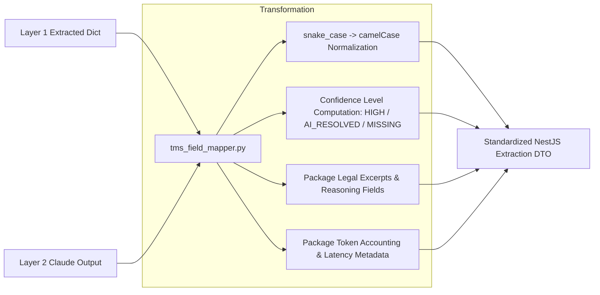

The final processing stage inside VolksAI is **`tms_field_mapper.py`** (33 KB). Its responsibility is to normalize raw Python data structures into the exact camelCase Data Transfer Object (DTO) contract expected by the NestJS backend and React frontend.

## DTO Normalization Pipeline

---

## 1. Key Field Transformations

The mapper converts internal domain representations into standardized frontend types:

| Python Internal Key | NestJS CamelCase DTO Key | Type | Description |
| :--- | :--- | :--- | :--- |
| `tender_number` | `tenderNumber` | `string` | Bid number (e.g. `GEM/2026/B/123456`) |
| `organization_name`| `organizationName` | `string` | PSU / Ministry issuing the tender |
| `tender_value` | `tenderValue` | `number` | Estimated order value in INR |
| `bid_end_date` | `bidEndDate` | `ISO string` | Bid submission deadline timestamp |
| `emd_amount` | `emdAmount` | `number` | Earnest Money Deposit in INR |
| `pbg_percentage` | `pbgPercentage` | `number` | Performance guarantee percentage |
| `payment_terms_supply_display` | `paymentTermsSupplyDisplay` | `string` | Supply milestone description |
| `ld_percentage_per_week` | `ldPercentagePerWeek` | `number` | Delay penalty rate per week |

---

## 2. Confidence Level Computation

Every single field in the DTO is tagged with an explicit provenance level:

1. **`HIGH`:**
   * Computed when the field was populated directly by Layer 1 spatial table parsing or deterministic regex.
   * Rendered in the frontend as a GREEN badge.
2. **`AI_RESOLVED`:**
   * Computed when the field was resolved by Claude Role 1 (missing field fallback) or Role 2 (ambiguity resolver).
   * Rendered in the frontend as an AMBER badge with an interactive reasoning tooltip.
3. **`MISSING`:**
   * Computed when neither Layer 1 nor Layer 2 located the clause in the document.
   * Rendered in the frontend as a RED badge.

---

## 3. Packaging Legal Audit Trails

For every field resolved by an LLM, `tms_field_mapper.py` attaches two audit attributes:
* **`{field}_reasoning`:** Claude's legal rationale explaining why it chose this milestone or rate over conflicting clauses.
* **`{field}_clause_excerpt`:** The exact verbatim text excerpt from the tender text (with page references) that justified the choice.

These attributes are saved directly into PostgreSQL `tender_extractions.fields`, ensuring bidding engineers can verify AI assertions with zero friction.
